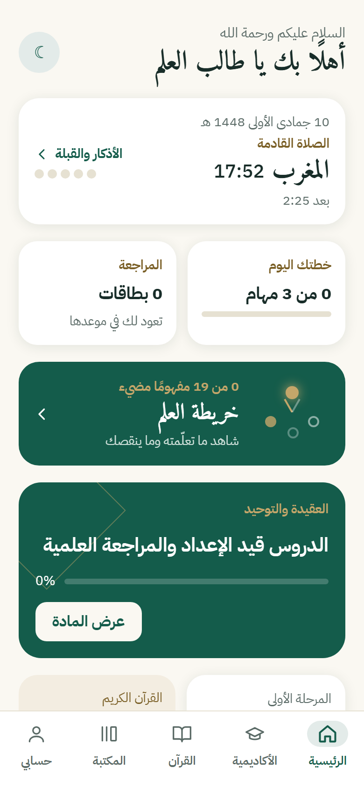
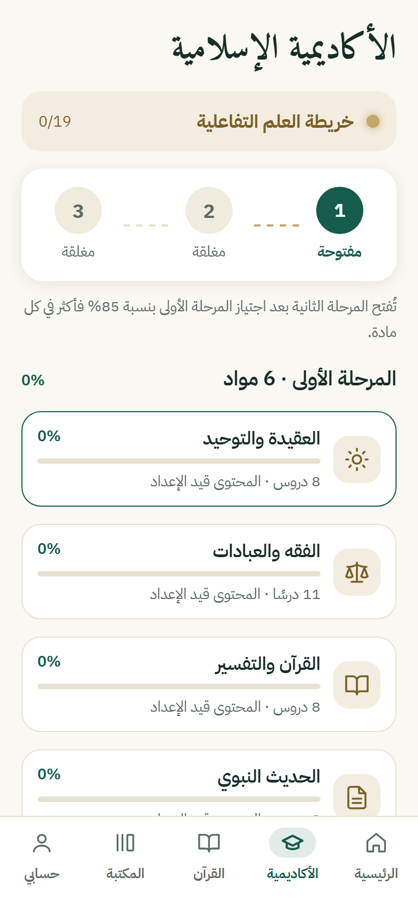
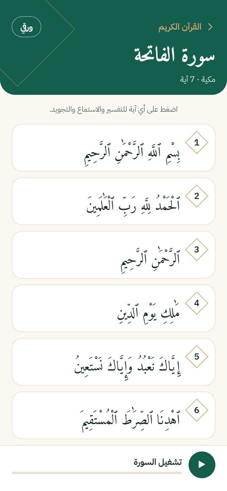
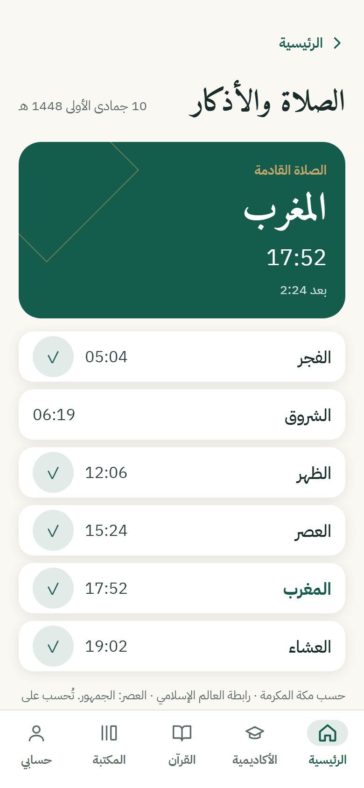

<p align="center">
  
</p>

<p align="center">
  <a href="https://github.com/mahmoudteirdev/Baseera/releases"></a>
  
  
  
  
</p>

<p align="center">
  
  
  
  <a href="https://github.com/mahmoudteirdev/Baseera"></a>
</p>

<p align="center">
  <a href="docs/COVERAGE.md"></a>
  <a href="docs/TRACEABILITY.md"></a>
  <a href="#️-baseerah-console-admin"></a>
  <a href="docs/IOS_INSTALLATION.md"></a>
</p>

<br />

<p align="center">
  &nbsp;&nbsp;
  &nbsp;&nbsp;
  &nbsp;&nbsp;
  
</p>

---

## 👨‍💻 About Baseerah

```yaml
name: بصيرة · Baseerah
version: 1.2.5 (versionCode 9)
repository: https://github.com/mahmoudteirdev/Baseera
purpose: Free, ad-free Arabic (RTL) platform for studying the Islamic sciences
tracks:
  academy: Staged curriculum (Foundations, Consolidation, Specialization), quizzes, certificates & SRS
  tawheed: 7 structured Tawheed & Yaqeen gateways (/tawheed) with interactive progression
  quran: Tanzil Uthmani text (604-page Madinah layout), per-ayah EveryAyah audio & multi-engine Tafsir
  library: Verified classical texts, 20-volume chunked Al-Bidaya wa Al-Nihaya, & typographic leather covers
  lexicon: Islamic terminology glossary (/terms) & 99 Names of Allah (/names)
  worship: Prayer times (Adhan), Android Home Widget, Qibla (compass, map & 3D Kaaba), Adhkar & Tasbeeh
  operations: Native Mobile Admin Console (/admin) & In-App Direct APK Auto-Updater
ships_to: [Web, iOS, Android]
backend: Supabase (PostgreSQL + RLS, Auth, Deno Edge Functions, Storage)
golden_rule: >
  Religious accuracy first. Source-verified verses, hadiths, tafsir, adhkar, and texts
  go through scholarly review and audit logging before publishing.
```

---

## ✨ Key Capabilities & Recent Releases (`v1.2.5`)

- **📕 Classical Typographic Heritage Book Covers (`BookCover.tsx`):** Zero-byte network payload SVG + Amiri display covers with category-specific leather binding palettes, double gold-foil borders, Rub-el-Hizb corner knots, and embossed spine ribbing across library shelves, readers, and admin views.
- **📜 Chunked Encyclopedia Reader (`PagedBookReader`):** On-demand volume streaming and offline local caching for massive multi-volume works—powering the full 20-volume *Al-Bidaya wa Al-Nihaya* (~13,078 pages) smoothly without memory bloat.
- **📚 Expanded Verified Library & Lexicon:** Over 30 published scholarly texts including *Umdat al-Ahkam*, *Riyad as-Salihin*, *Al-Aqeedah Al-Tahawiyyah*, *Usul ath-Thalatha*, *Al-Arba'in an-Nawawiyyah*, *Al-Jazariyyah*, *Tuhfat al-Atfal*, and a 46+ term Islamic glossary (`/terms`).
- **📱 Native Mobile Admin Console (`/admin`):** Redesigned mobile-native management dashboard using Baseerah's design primitives (`MobileAdminDashboard.tsx`) for inspecting books, editing titles/chapters, reviewing drafts, managing staff, and publishing OTA APK releases.
- **🔄 In-App Direct OTA Updater (`updater.ts`):** Downloads signed APK releases directly inside the app with live progress and launches the Android Package Installer securely via FileProvider.
- **🕌 Quran, Multi-Tafsir & Worship Suite:** 604-page Madinah Mushaf, per-ayah audio, *As-Saadi* / *Ibn Kathir* / *Al-Muyassar* tafsir, Khatmah planner, Qibla compass + world map + Three.js 3D Kaaba, Android Home Screen Prayer Widget, and haptic Tasbeeh counter.

---

## 🧰 Tools and Tech

<p align="center">
  &nbsp;
  &nbsp;
  &nbsp;
  &nbsp;
  &nbsp;
  &nbsp;
  &nbsp;
  &nbsp;
  &nbsp;
  
</p>

| Layer | Technology & Decisions |
|---|---|
| **Framework** | Expo SDK 58, React Native 0.88, React 19.3, TypeScript (strict), React Compiler |
| **Routing** | Expo Router v58 (typed file-based routes in `src/app/`, static web export) |
| **Motion** | React Native Reanimated 4 + Worklets |
| **State & Validation** | Zustand (persisted to AsyncStorage, local-first) + Zod runtime schemas |
| **Quran & Tafsir** | Tanzil Uthmani v1.1 (`assets/quran/quran-uthmani.txt`), EveryAyah audio, 604-page index |
| **Prayer & Hijri** | `adhan` astronomical library, Umm al-Qura Hijri (`@umalqura/core`), Android Home Widget |
| **3D & Geospatial** | `three` + `@react-three/fiber` (3D Kaaba), `d3-geo` + `world-atlas` (Qibla map), SVG compass |
| **Backend** | Supabase PostgreSQL with strict RLS, Auth, Deno Edge Functions, & Storage |
| **Testing** | Jest + React Native Testing Library, PGlite in-process SQL/RLS harness, Playwright E2E |

```text
src/
  app/            Expo Router screens (tabs: home, academy, quran, library, account; /admin, /book/[id], /tawheed, /terms)
  components/     Core design primitives (Button, Card, Chip, EvidenceBlock, Txt, …), layouts & overlays
  features/       Academy, Admin (MobileAdminDashboard & Console), Encyclopedia, Library Covers, Prayer, Qibla, Kaaba, Updater
  services/       Supabase client, Auth, Sync, Audio, Muadhin, Tafsir, Notifications, Encyclopedia chunk loader, OTA Updater
  state/          Zustand persisted stores (app-store, content-store, config-store, tawheed-store, ui-store)
  data/           Structural taxonomy, Quran metadata/pages, Islamic terms, Tawheed gateways, & defaults
  theme/          Design tokens, Arabic typography helpers, & RTL layout metrics
  widgets/        Android Home Screen prayer widget views & background task handler
assets/           Tanzil Quran text, Adhan audio, fonts, & launcher icons
backend/supabase/ Migrations, Deno Edge Functions, & config.toml (empty seed.sql)
plugins/          Expo config plugins (CMake path shortening, release signing, ProGuard rules)
tests/ e2e/       Jest test suites, Playwright web E2E, & PGlite backend verification
```

---

## 🚀 Getting Started

### 1. Install Dependencies

Requires **Node 22 LTS+** (verified on Node 25). For native Android builds, Android Studio (bundled JDK 21) and Android SDK are required.

```bash
npm install
```

### 2. Environment Configuration

```bash
cp .env.example .env.local
```

| Variable | Purpose |
|---|---|
| `EXPO_PUBLIC_SUPABASE_URL` | Supabase project URL |
| `EXPO_PUBLIC_SUPABASE_ANON_KEY` | Supabase **publishable/anon** key (if omitted, app runs offline/local) |
| `EXPO_PUBLIC_SITE_URL` | Public site URL for auth redirects & certificate verification links |
| `EXPO_PUBLIC_RECITATION_CDN` | Per-ayah audio CDN (defaults to `https://everyayah.com/data`) |
| `APP_VARIANT` | `development` \| `staging` \| `production` |

> [!CAUTION]
> Only `EXPO_PUBLIC_*` values are bundled into client builds. Never store `SUPABASE_SERVICE_ROLE_KEY`, admin passwords, or database credentials in client source files.

### 3. Run Locally & Build

| Target | Command |
|---|---|
| **Web Dev Server** | `npm run web` (`http://localhost:8081`) |
| **Web Static Build** | `npm run export:web` → `npm run serve:web` (`http://127.0.0.1:4173`) |
| **Android Dev** | `npx expo run:android` |
| **Android Release APK** | `npx expo prebuild -p android` then `npm run build:android:apk` |
| **iOS (Mac / Cloud CI)** | `npx expo run:ios` or GitHub Actions `.github/workflows/build-ios.yml` ([Guide](docs/IOS_INSTALLATION.md)) |

---

## 🗄️ Backend (Supabase)

1. **Link & Push Migrations:**
   ```bash
   npx supabase link --workdir backend --project-ref <project-ref>
   npx supabase db push --workdir backend
   ```
2. **Deploy Edge Functions:** `submit-report`, `submit-feedback`, `grade-quiz`, `issue-certificate`, `verify-certificate`, `delete-account`, `notify-reporter`:
   ```bash
   npx supabase functions deploy --workdir backend --use-api
   npx supabase secrets set --workdir backend REPORT_SALT=<random> ALLOWED_ORIGIN=https://your-site
   ```
3. **Auth & Admin Role:** Sign up a user in the app, then grant `'admin'` in `public.staff` via the Supabase SQL Editor.

---

## 🛠️ Baseerah Console (`/admin`)

Staff members access the console from **المزيد ← الإعدادات ← لوحة الإدارة والتحكم** or `/admin`.

- **Mobile-Native Admin (`MobileAdminDashboard.tsx`):** Overview metrics, Library book & chapter inspection with heritage covers, inline book editor, OTA APK release publisher, pending draft approvals, and Islamic glossary browser.
- **Full Desktop Console (`Console.tsx`):** Multi-panel review queues, 2-scholar lesson approval workflow, learner stats, certificate audit logs, feedback inbox, prayer & curriculum defaults, and CSV/JSON exports.

---

## ✅ Verification & Tests

| Command | Scope |
|---|---|
| `npm run typecheck` | TypeScript strict type-checking (`tsc --noEmit`) |
| `npm run lint` | ESLint + React Compiler rules (`expo lint`) |
| `npm test` | Jest unit & component test suites (94 tests) |
| `npm run test:backend` | PGlite PostgreSQL migrations, RLS, & workflow checks |
| `npm run test:e2e` | Playwright cross-viewport web end-to-end suite |

---

## 📈 GitHub History

<p align="center">
  &nbsp;
  
</p>

<p align="center">
  
</p>

---

## 📜 Content & Licensing

- **Quran Text:** Tanzil Project, Uthmani v1.1 (`assets/quran/quran-uthmani.txt`), licensed CC BY 3.0.
- **Recitation:** Streamed per ayah via EveryAyah CDN.
- **Typography:** IBM Plex Sans Arabic, Amiri, Amiri Quran, Aref Ruqaa, Noto Naskh Arabic, and Tajawal (SIL Open Font License).
